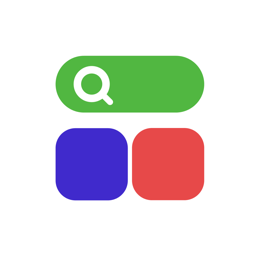
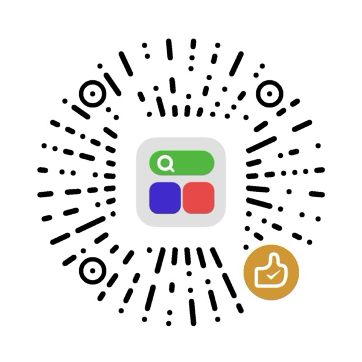

<p align="center">
  
</p>

<h1 align="center">AppPad</h1>

<p align="center">
  あの Launchpad を macOS 26+ に取り戻す（macOS 15 にも対応）。クリップボード、ワークフロー、アプリのショートカット、ウインドウ操作も搭載。
</p>

<p align="center">
  <a href="https://apppad.youmindhub.com">Web サイト</a><br>
  <a href="#wechat-donate">☕ WeChat で応援</a>
</p>

<p align="center">
  <a href="README.md">English</a> ·
  <a href="README.zh-CN.md">简体中文</a> ·
  <a href="README.zh-TW.md">繁體中文</a> ·
  日本語 ·
  <a href="README.ko.md">한국어</a> ·
  <a href="README.de.md">Deutsch</a> ·
  <a href="README.es.md">Español</a> ·
  <a href="README.fr.md">Français</a> ·
  <a href="README.it.md">Italiano</a> ·
  <a href="README.nl.md">Nederlands</a>
</p>

---

## インストール

### 方法 1：DMG をダウンロード

[最新版をダウンロード](https://github.com/umindhub/AppPad/releases/latest)し、DMG を開いて AppPad を「アプリケーション」フォルダにドラッグします。

### 方法 2：Homebrew

```bash
brew tap umindhub/tap
brew trust umindhub/tap
brew install --cask apppad
```

## 機能

### Launchpad
- クラシックな macOS の Launchpad を忠実に再現、デフォルトの配置はシステムと同じ順序
- 4 本指のピンチ、メニューバー、または Dock の AppPad をクリックで開く（もう一度クリックで閉じる）
- フォルダ、ドラッグで並べ替え / フォルダを作成、アイコンの長押しまたは ⌥ キーを押したままで編集モード
- クリーンアンインストール内蔵：アプリと残ったファイルをまとめて削除
- グリッド検索、ページインジケータ（ドット / 数字）、Liquid Glass コントロール（macOS 26+）
- 背景：ホワイト / ライトグレイ / ダークグレイ / 壁紙 / カスタムカラー、ライト・ダークの外観ごとに個別設定

### クリップボード
- テキストと画像を永久に保存
- コピーした内容を保存可能
- `⌘1`–`⌘0` ですばやくペースト、コピー元アプリで絞り込み、`アプリ名::` 検索構文、リアルタイムプレビュー

### ワークフロー & AI MCP
- `⌘Space` でワークフローパネルを開く：アプリとワークフローを使用頻度でまとめて並べ替え
- ワークフローはシェルスクリプト、AppleScript、ショートカット、HTTP リクエストを実行、引数にも対応（例：`time 10`）
- 内蔵：ゴミ箱を空にする、タイマーを設定、アラームを設定、音量を設定、すべてのアプリを終了…
- 宣言された権限を本物のサンドボックスで強制（1回のみ許可 / 許可しない / 常に許可）
- JSON ファイルまたはリンクでワークフローを読み込み・共有
- MCP サーバーを内蔵：MCP 対応の AI アシスタントからワークフローを直接呼び出し・操作
- AI は MCP 経由でワークフローの作成ルールを読み取り、新しいワークフローを作成可能
- AI が実行するワークフローも、手動実行と同じ権限確認とサンドボックスを経由

### 計算機
- ワークフローパネルの検索フィールドに数式を入力するだけで計算（指数表記に対応）

### アプリのショートカット
- 任意のアプリにグローバルショートカットを割り当て

### ウインドウ操作
- 左 / 右に配置（½ → ⅓ → ⅔）、最大化、元に戻す、別のディスプレイへ移動 — ショートカットはすべてカスタマイズ可能

### その他
- ログイン時に起動
- `⌘⇧J` / `⌘⇧K` で Launchpad、クリップボード、ワークフローをアニメーションで切り替え
- 10 言語：de、en、es、fr、it、ja、ko、nl、zh-Hans、zh-Hant

## 動作環境

- macOS 15 以降
- Xcode 27（ソースからビルドする場合）

## ビルド

1. `AppPad.xcodeproj` を開く
2. スキームを選択：`AppPad Dev`、`AppPad Beta`、`AppPad`
3. 自分の署名チームを設定し、ビルドして実行

依存関係は Swift Package Manager で解決されます。

## ライセンス

AppPad は分割ライセンスを採用しています：

| 対象 | ライセンス |
| --- | --- |
| AppPad アプリのソースコード（下記以外のすべて） | [AGPL-3.0](LICENSE) |
| 内蔵ワークフロー（`AppPad/Workflow/BuiltinWorkflows.swift`、`*.shortcut`） | [MIT](LICENSE-MIT) |
| ワークフロー形式の仕様 | [MIT](LICENSE-MIT) |
| ワークフローマーケットのサードパーティ製ワークフロー | [MIT](LICENSE-MIT)、著作権は各作者 |

- **AGPL-3.0**：AppPad の使用・改変・再配布は自由ですが、配布またはネットワーク経由で提供する派生物は、全ソースコードとともに AGPL-3.0 で公開する必要があります。
- **商用ライセンス**：クローズドソースや独占的な用途には、[Web サイト](https://apppad.youmindhub.com)から作者に連絡して商用ライセンスを取得してください。
- **ワークフローは MIT**：誰でもワークフローを自由に作成・共有・販売でき、ワークフロー形式を他のツールに実装することもできます。AGPL の義務は発生しません。
- 自分で作成したワークフローはあなたのものです。ワークフローマーケットに投稿するワークフローは MIT ライセンスである必要があります。
- 「AppPad」の名称とアイコンはこれらのライセンスの対象外です。フォークでは別の名称とアイコンを使用してください。

## コントリビュート

Issue と Pull Request を歓迎します。コントリビューションを送信することで、その内容が変更箇所のライセンスで公開されること、およびメンテナが商用ライセンスでも配布できる権利を付与することに同意したものとみなします。

## 謝辞

- [GRDB.swift](https://github.com/groue/GRDB.swift) — MIT ライセンス
- [Sparkle](https://github.com/sparkle-project/Sparkle) — MIT ライセンス

<a id="wechat-donate"></a>

## AppPad を応援する

AppPad は無料のオープンソースです。Mac が少しでも使いやすくなったと感じていただけたら、WeChat でコーヒーを一杯ごちそうしていただけるとうれしいです。金額はお気持ちで大丈夫です。GitHub のスターも大きな励みになります。ありがとうございます！

<p align="center">
  
  <br>
  <sub>WeChat でスキャン</sub>
</p>

---

© 2026 YouMindHub
