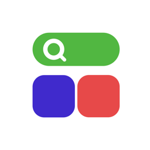

<p align="center">
  
</p>

<h1 align="center">AppPad</h1>

<p align="center">
  あの Launchpad を macOS 26+ に取り戻す（macOS 15 にも対応）。クリップボード、ワークフロー、アプリのショートカット、ウインドウ操作も搭載。
</p>

<p align="center">
  <a href="https://apppad.youmindhub.com">Web サイト</a> · <a href="CHANGELOG.ja.md">変更履歴</a>
</p>

<p align="center">
  <a href="../../README.md">English</a> ·
  <a href="README.zh-CN.md">简体中文</a> ·
  <a href="README.zh-TW.md">繁體中文</a> ·
  日本語 ·
  <a href="README.ko.md">한국어</a> ·
  <a href="README.de.md">Deutsch</a> ·
  <a href="README.es.md">Español</a> ·
  <a href="README.fr.md">Français</a> ·
  <a href="README.it.md">Italiano</a> ·
  <a href="README.nl.md">Nederlands</a>
</p>

---

## インストール

### 方法 1：DMG をダウンロード

[最新版をダウンロード](https://github.com/umindhub/AppPad/releases/latest)し、DMG を開いて AppPad を「アプリケーション」フォルダにドラッグします。

### 方法 2：Homebrew

```bash
brew tap umindhub/tap
brew trust umindhub/tap
brew install --cask apppad
```

## 機能

### Launchpad
- クラシックな macOS の Launchpad を忠実に再現、デフォルトの配置はシステムと同じ順序
- 4 本指のピンチ、メニューバー、または Dock の AppPad をクリックで開く（もう一度クリックで閉じる）
- フォルダ、ドラッグで並べ替え / フォルダを作成、アイコンの長押しまたは ⌥ キーを押したままで編集モード
- クリーンアンインストール内蔵：アプリと残ったファイルをまとめて削除
- グリッド検索、ページインジケータ（ドット / 数字）、Liquid Glass コントロール（macOS 26+）
- 背景：ホワイト / ライトグレイ / ダークグレイ / 壁紙 / カスタムカラー、ライト・ダークの外観ごとに個別設定

### クリップボード
- テキストと画像を永久に保存
- コピーした内容を保存可能
- `⌘1`–`⌘0` ですばやくペースト、コピー元アプリで絞り込み、`アプリ名::` 検索構文、リアルタイムプレビュー

### ワークフロー & AI MCP
- `⌘Space` でワークフローパネルを開く：アプリとワークフローを使用頻度でまとめて並べ替え
- ワークフローはシェルスクリプト、AppleScript、ショートカット、HTTP リクエストを実行、引数にも対応（例：`time 10`）
- 内蔵：ゴミ箱を空にする、タイマーを設定、アラームを設定、音量を設定、すべてのアプリを終了…
- 宣言された権限を本物のサンドボックスで強制（1回のみ許可 / 許可しない / 常に許可）
- JSON ファイルまたはリンクでワークフローを読み込み・共有
- MCP サーバーを内蔵：MCP 対応の AI アシスタントからワークフローを直接呼び出し・操作
- AI は MCP 経由でワークフローの作成ルールを読み取り、新しいワークフローを作成可能
- AI が実行するワークフローも、手動実行と同じ権限確認とサンドボックスを経由

### 計算機
- ワークフローパネルの検索フィールドに数式を入力するだけで計算（指数表記に対応）

### アプリのショートカット
- 任意のアプリにグローバルショートカットを割り当て

### ウインドウ操作
- 左 / 右に配置（½ → ⅓ → ⅔）、最大化、元に戻す、別のディスプレイへ移動 — ショートカットはすべてカスタマイズ可能

### その他
- ログイン時に起動
- `⌘⇧K` / `⌘⇧J` で Launchpad、ワークフロー、クリップボードをアニメーションで切り替え
- 10 言語：de、en、es、fr、it、ja、ko、nl、zh-Hans、zh-Hant

## 動作環境

- macOS 15 以降

## ライセンス

AppPad はプロプライエタリな商用ソフトウェアです。© 2026 YouMindHub. All rights reserved. このリポジトリにはリリース版とドキュメントのみを置いており、ソースコードは公開していません。

| 対象 | ライセンス |
| --- | --- |
| AppPad アプリ | プロプライエタリ（All rights reserved） |
| 内蔵ワークフロー | [MIT](../LICENSE-MIT) |
| ワークフロー形式の仕様 | [MIT](../LICENSE-MIT) |
| ワークフローマーケットのサードパーティ製ワークフロー | [MIT](../LICENSE-MIT)、著作権は各作者 |

- **ワークフローは MIT**：誰でもワークフローを自由に作成・共有・販売でき、ワークフロー形式を他のツールに実装することもできます。
- 自分で作成したワークフローはあなたのものです。ワークフローマーケットに投稿するワークフローは MIT ライセンスである必要があります。
- 「AppPad」の名称とアイコンは MIT ライセンスの対象外です。

## 謝辞

- [GRDB.swift](https://github.com/groue/GRDB.swift) — MIT ライセンス
- [Sparkle](https://github.com/sparkle-project/Sparkle) — MIT ライセンス

---

© 2026 YouMindHub
